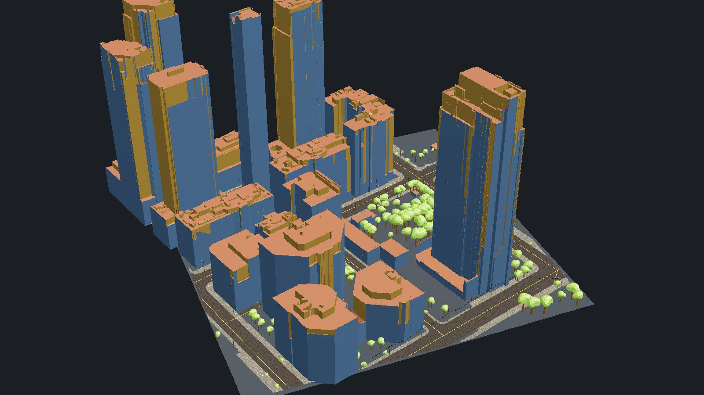
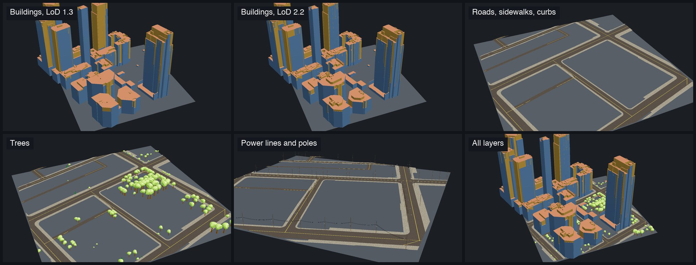
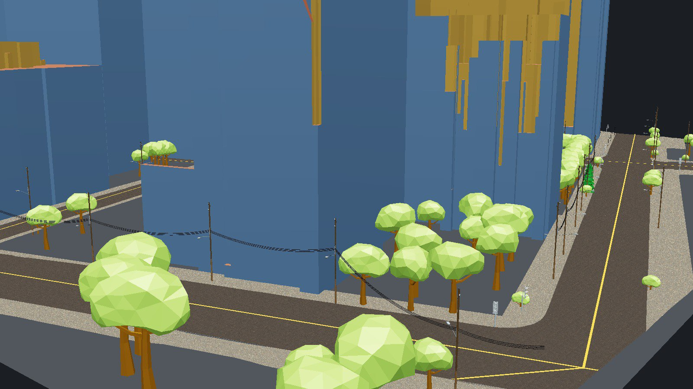
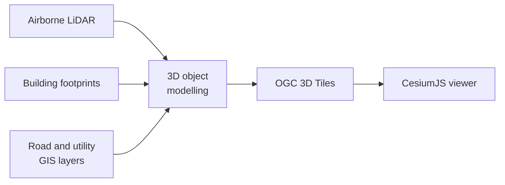

<div align="center">

# Geospatial Cookbook

**Practical examples and sample data for geospatial data processing, from raw measurements to 3D scenes you can open and explore.**

[](https://www.ogc.org/standards/3dtiles/)
[](https://cesium.com/platform/cesiumjs/)
[](https://www.python.org/)


[](LICENSE)



<sub>The Toronto sample scene in CesiumJS: LoD 2.2 buildings, roads, trees, power lines and poles.</sub>

</div>

## About

Geospatial workflows are easier to learn from data you can actually open. This repository collects small, self-contained examples, each with its own code, sample data and instructions.

Every example aims to be:

- **Runnable:** it works with the data in its folder.
- **Small:** the sample is cut down so the structure is easy to inspect.
- **Open:** it uses open standards, and needs no paid service or API key.

## Contents

| Topic | Example | What it shows | Status |
| --- | --- | --- | --- |
| 3D Tiles | [Toronto scene](3d-tiles/toronto-scene/) | A 250 × 250 m multi-layer urban scene with a simple CesiumJS viewer | Available |

```text
.
├── 3d-tiles/
│   └── toronto-scene/      Sample scene and viewer
│       ├── index.html      CesiumJS viewer
│       ├── README.md       Details of this example
│       └── data/           OGC 3D Tiles, one folder per layer
└── docs/
    └── images/             Figures used in this page
```

## Featured example: Toronto scene

A multi-layer 3D urban scene built from individual objects rather than a single draped mesh. Each layer can be switched on or off, and clicking an object shows its attributes.



| Layer | In the sample |
| --- | --- |
| Buildings at LoD 1.3 and LoD 2.2 | 19 buildings with attributes |
| Roads, sidewalks, curbs and centre lines | Surfaces with PBR textures and attributes |
| Trees | 142 instanced trees with attributes |
| Power lines | One stretch of line with attributes |
| Poles, street lights and signals | 68 instanced poles with attributes |



### How it fits together



### Quick start

From a clone of this repository:

```bash
cd 3d-tiles/toronto-scene
python3 -m http.server 8000
```

Then open <http://localhost:8000>. See the [example's README](3d-tiles/toronto-scene/README.md) for its extent, coordinate systems and notes.

## Next features

- [ ] **Texture mapping:** apply realistic textures to reconstructed building roofs and walls.
- [ ] **Making models live:** connect the 3D models to live data, so the scene reflects real-world conditions as they change.

## License

The tools in this repository are released under the [MIT License](LICENSE).

**Author:** M.Eng. Farshad Golparvar ([farshad.gol901@gmail.com](mailto:farshad.gol901@gmail.com))
